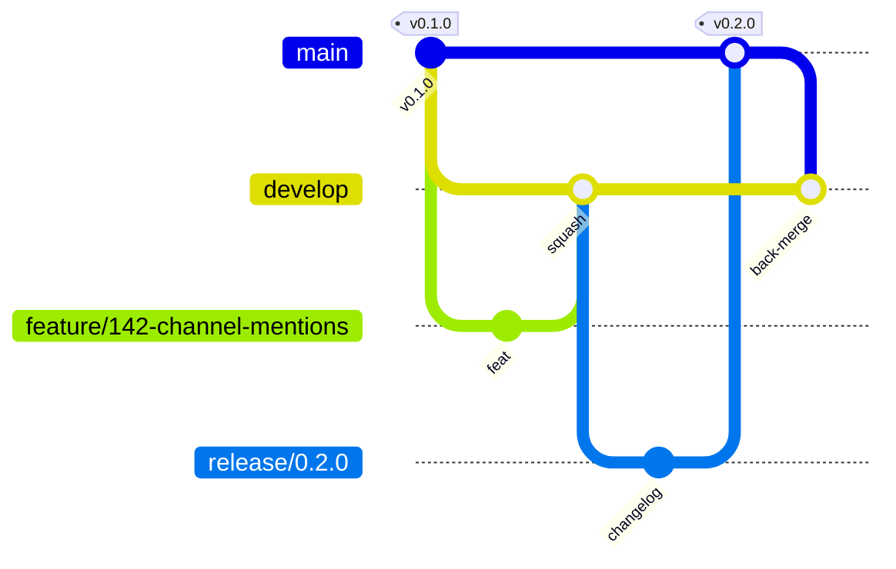

# Contributing to SmartConnect

New to the project? Start with [docs/onboarding.md](docs/onboarding.md). This guide covers how changes move from a branch to `main`.

## Branching model



| Branch | Purpose | Created from | Merges into | Protected |
|---|---|---|---|---|
| `main` | Production-ready, every commit tagged or releasable | — | — | Yes: PR only, all checks green, 2 approvals, no force-push or deletion (merge commits allowed for releases) |
| `develop` | Integration branch, always deployable to staging | `main` | `main` (via release PR) | Yes: PR only, all checks green, 1 approval |
| `feature/*`, `fix/*`, `chore/*`, `docs/*`, `refactor/*`, `test/*`, `ci/*` | One unit of work | `develop` | `develop` (squash) | No |
| `release/x.y.z` | Optional stabilisation before a release (changelog, version bump, fixes only) | `develop` | `main` (merge commit), then back-merged to `develop` | No |
| `hotfix/*` | Urgent production fix | `main` | `main` (squash), then back-merged to `develop` | No |

- Feature work **never** targets `main` directly.
- Releases: open a PR `develop → main` (or `release/x.y.z → main`), merge with a merge commit, tag `vX.Y.Z` on `main`, then merge `main` back into `develop`.
- Delete branches after merging.

### Branch names

```
<type>/<issue-number>-<short-kebab-description>
```

- `type` is one of `feature`, `fix`, `hotfix`, `chore`, `docs`, `refactor`, `test`, `ci`, `release`.
- Lowercase, hyphen-separated, at most ~50 characters, with the issue number when one exists.
- Examples: `feature/142-channel-mentions`, `fix/207-rls-invitation-lookup`, `chore/311-bump-prisma-7-11`, `release/0.2.0`.

## Commits and pull request titles

We use [Conventional Commits](https://www.conventionalcommits.org/). Because PRs are **squash-merged**, the PR title becomes the commit on `develop`, so it must follow the format:

```
<type>(<scope>): <imperative summary>
```

- **Types:** `feat`, `fix`, `perf`, `refactor`, `test`, `docs`, `chore`, `ci`, `build`, `revert`. Append `!` (e.g. `feat(api)!:`) for breaking changes and describe the break in the body.
- **Scopes:** a service name (`messaging`, `workspace`, …), `web`, `mobile`, `gateway`, `db`, `infra`, `ci`, `deps`, `docs`.
- **Examples:** `feat(messaging): add thread follow notifications`, `fix(db): scope organization read policies to user context`.

## Pull requests

1. Branch from an up-to-date `develop`. Open a **draft PR early** for visibility.
2. Keep PRs small: ideally under ~400 changed lines (excluding generated files and lockfiles), one concern per PR.
3. Fill in the PR template. It includes the database and security checklists.
4. Run the checks locally before requesting review:
   ```bash
   make ci-local       # format, lint, Prisma validate/generate, typecheck, unit tests, build, audit
   make db-test        # when anything under smartconnect-backend/, infrastructure/ or tests/ changed
   ```
5. CI must be green. Skipped jobs (e.g. a frontend app that does not exist yet) are shown as **skipped**, not passed. See [docs/devops/ci.md](docs/devops/ci.md).
6. Approvals:
   - **1** approval for normal changes.
   - **2** for database migrations, RLS/privileges, `infrastructure/`, CI workflows, dependency major upgrades and anything touching authentication.
   - Code owners review their areas once CODEOWNERS is activated.
7. The **author merges** (squash) after approval. Resolve all conversations first.

### Reviewing

Review for correctness, tenant isolation, security, tests and readability, in that order. Prefix optional remarks with `nit:`. Request changes for:
- **Data and tenancy:** missing tests for new behaviour, tenant data accessed outside `withTenant()`, or cross-service schema access.
- **Unsafe values:** secrets, or unvalidated input.
- **Migrations:** edits to applied migrations.

## Definition of done

- [ ] Acceptance criteria met; tests added or updated (unit, plus database suites where relevant)
- [ ] `make ci-local` and CI green; no new lint warnings
- [ ] Docs updated (README, `docs/`, ADR for significant decisions in `docs/decisions/`)
- [ ] No secrets or real data committed; migrations reviewed

## Non-negotiable rules

These are enforced by tests or CI where possible:

- **Secrets:** never commit `.env`, `.env.migration`, credentials, tokens, backups or customer data. `.gitignore` covers the known files; check `git status` before every commit.
- **Data ownership:** each service owns its schema. No cross-schema queries, no shared Prisma client. Use APIs and events ([docs/database/architecture.md](docs/database/architecture.md)).
- **Tenant data:** query tenant tables only inside `withTenant()` ([docs/database/tenant-isolation.md](docs/database/tenant-isolation.md)).
- **Migrations:** `make db-migration` only; forward-only; never `prisma db push`, `migrate reset` or `migrate dev` against the dev database ([docs/database/migrations.md](docs/database/migrations.md)).
- **Dependencies:** pin exact versions and don't install `@latest` blindly. The `prisma` CLI's `latest` npm tag pointed at a release candidate.
- **Workspace layout:** never add a `package.json` to a directory that contains other workspaces. npm 10 silently skips dependencies in that layout ([docs/decisions/0001-monorepo-npm-workspaces.md](docs/decisions/0001-monorepo-npm-workspaces.md)).
