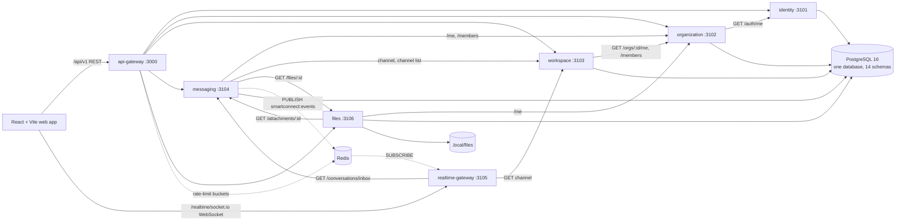

# SmartConnect: Unified Backend Architecture Audit

- **Date:** 2026-11-03
- **Scope:** every backend package in `smartconnect-backend/`, with the database bootstrap, Redis configuration, the frontend's API and socket settings, the test suites and CI. The audit was read-only: no source, schema, migration, environment or infrastructure file was changed. Environment files were read for variable **names only**, never values.
- **Question:** can SmartConnect's backend become one modular NestJS application that starts with one command and deploys as one Render Web Service, while keeping today's functionality, API contracts, database, security and realtime behaviour?

**Short answer:** yes, but only as a staged migration. A one-step merge would break authorization: four services register their access guards globally, and in one Nest application those guards would run on every module's routes (§10, B1). The recommendation is in §11.

---

## 1. Current backend architecture

SmartConnect's backend is a set of NestJS 12 (ESM) processes in one npm workspace monorepo ([ADR 0001](docs/decisions/0001-monorepo-npm-workspaces.md)). In development, each process starts with its own `make <name>-start` target.

| Deployable | Default port | Role | Data |
|---|---|---|---|
| `api-gateway` | 3000 | Public HTTP edge: verifies access tokens, applies rate limits, sets CORS, checks the origin of cookie requests, enforces body policy, and forwards each route to its owning service | None. Redis for rate limits |
| `realtime-gateway` | 3105 | Socket.IO at `/realtime/socket.io`: authenticates sockets, authorizes rooms through other services, and fans out id-only events | None. Redis pub/sub subscriber |
| `services/identity` | 3101 | Accounts, login, sessions, refresh rotation, password and email flows, platform-role lookups | `identity` schema |
| `services/organization` | 3102 | Organizations, roles, members, invitations, departments, teams, platform organization directory | `organization` schema |
| `services/workspace` | 3103 | Workspaces, workspace membership, channels, channel membership | `workspace` schema |
| `services/messaging` | 3104 | Channel messages, direct and group conversations, threads, reactions, mentions, bookmarks, read state, activity, preferences, message search, attachment links | `messaging` schema. Redis publisher |
| `services/files` | 3106 | File metadata and bytes on the local filesystem; access for uploaders and through attachments | `files` schema plus a disk directory |

The other **nine** service directories (`administration`, `documents`, `integrations`, `meetings`, `notifications`, `presence`, `search`, `tasks`, `workflows`) contain **only** a Prisma schema, its migrations and `src/database/client.ts` (56 lines). They have no NestJS application, no routes and no `main.ts`. Their schemas exist in the database and are migrated, but no code reads or writes them.



Cross-cutting facts that shape a merge:

- **Authentication:** identity alone signs Ed25519 access tokens (`at+jwt`, 15 minutes by default). Every other process verifies them with the public JWKS ([ADR 0009](docs/decisions/0009-identity-and-authentication.md)). Tokens carry identifiers only; roles and permissions are looked up on each request.
- **Service-to-service authentication:** none exists. Internal calls forward the **end user's own** `Authorization` header and the request id. The called service re-verifies the token and authorizes the user itself ([ADR 0010](docs/decisions/0010-organizations-and-membership.md), [ADR 0013](docs/decisions/0013-collaboration-platform-expansion.md) §1). The kit's `ServiceClient` makes only GET calls, with a 5-second timeout, no retries and no caching. A network failure becomes `503 dependency_unavailable`, so a failed call never grants access.
- **Session revocation:** only identity checks on every request that a token's session is still active (`ActiveSessionGuard`). Elsewhere a token stays valid until it expires, except where a service calls `/auth/me` (organization does so for creating an organization, accepting an invitation and platform administration).
- **Gateway posture:** the gateway forwards only an allowlist of request headers and drops client-sent `X-Forwarded-*` and identity headers. Only the refresh cookie reaches identity; no other cookie reaches any service. Bodies are JSON only, up to 1 MB, except the two streamed file-content routes. Services never trust identity headers (searched for and confirmed).

---

## 2. Service and module inventory

Line counts exclude the generated Prisma clients (`src/generated/`).

| Package | Hand-written TS | Controllers / routes | Main providers | DTOs |
|---|---|---|---|---|
| `api-gateway` | 11 files, 1,337 lines | Auth (14 forwarded routes), Admin (2), Messaging, Files, Workspace and Organization catch-all forwards, Health | `UpstreamProxy` (buffered and streaming), `RateLimitGuard` with Redis and memory stores, `AccessTokenGuard`, cookie-origin middleware | none (forwards only) |
| `realtime-gateway` | 10 files, 857 lines | Health only. Socket events: `subscribe`, `unsubscribe`, `inbox.subscribe`, `inbox.unsubscribe` | `RealtimeHub`, `ChannelDirectory` (asks workspace), `InboxDirectory` (asks messaging), `RedisEventSource` | strict event parsers |
| `identity` | 27 files, 2,116 lines | `auth` (6), `auth/email` (2), `auth/password` (3), `auth/sessions` (3), `admin` (1): **15 routes** | `AuthService`, `SessionService`, `PasswordService`, `EmailVerificationService`, `AccessTokenIssuer`, `PasswordHasher` (Argon2id), account notifier (SMTP, dev mailbox or disabled), `ActiveSessionGuard`, `SuperAdminGuard` | `auth/dto.ts`, `admin/dto.ts` |
| `organization` | 26 files, 2,510 lines | `orgs` (9), invitations (4 + 2 public or acceptance), departments (4), teams (8), `admin` (1): **28 routes** | `OrganizationsService`, `InvitationsService`, `StructureService`, `AdminService`, `IdentityClient`, `OrgMemberGuard` (`@UseGuards`), `SuperAdminGuard`, invitation notifier | per feature |
| `workspace` | 19 files, 1,710 lines | workspaces (9), channels (8), organization-wide channel list (1): **18 routes** | `WorkspacesService`, `ChannelsService`, `OrganizationDirectory`, `OrgMembershipGuard` (**global**) | per feature |
| `messaging` | 44 files, 4,692 lines | channel messages (11), conversations (19), activity (4), preferences (3), saved (1), search (1), attachments (1): **40 routes** | `MessagesService`, `ConversationsService`, `ConversationMessagesService`, `ActivityService`, `PreferencesService`, `SavedMessagesService`, `SearchService`, `AttachmentsService`, `ChannelDirectory`, `OrganizationDirectory`, `FileDirectory`, `VisibleChannels`, `RealtimePublisher`, `AccessGuard` (**global**) | per feature |
| `files` | 21 files, 1,431 lines | `orgs/:orgId/files`: **6 routes**, two of them streamed (`PUT`/`GET …/content`) | `FilesService` (in-memory counter of staged uploads), `AttachmentAccess` (asks messaging), `OrganizationDirectory`, `LocalFileStorage`, `StagingSweeper` (hourly), `OrgMembershipGuard` (**global**) | `files/dto.ts` |
| `packages/backend-kit` | 26 files, 1,973 lines | `HealthController` (`/health/live`, `/health/ready`), `DevMailboxController` (`dev/mailbox`) | HTTP pipeline (prefix `api/v1`, body policy, helmet, request ids via `AsyncLocalStorage`), RFC 9457 errors, `AccessTokenVerifier`, `AccessTokenGuard`, `@Public`, `ServiceClient`, config parsers, JSON logger, SMTP and Resend transports, `BackgroundMailer`, OpenAPI helpers | OpenAPI schemas |
| 9 schema-only services | 1 file each (56 lines) | none | none | none |
| `scripts` | dev seed, Super Admin seed | none | none | none |

**Repositories:** there is no repository layer. Services call Prisma directly inside `withTenant()` or `withUser()` transactions; messaging has one helper, `messages/message-store.ts`. Business logic lives in each feature's `*.service.ts`.

**Shared packages:**
- `smartconnect-backend/packages/backend-kit`: infrastructure only, by its own rule ("no data models, no business logic").
- `smartconnect-frontend/packages/design-tokens` and `ui`: frontend.
- The root `packages/` directory holds only a README.
- There is deliberately no shared Prisma client or schema package (rule in `docs/database/architecture.md`).

**Duplicated functionality:**

| What | Where | Note for a merge |
|---|---|---|
| `src/database/client.ts` (`createPrismaClient`, `withTenant`; organization adds `withUser`) | all 14 services | Intentional: each service has its own generated client and runtime role. **Keep.** |
| `OrganizationDirectory` (membership through `GET /orgs/:id/me`) | workspace, messaging, files | Three slightly different copies; becomes one in-process port |
| Organization membership gate with stale-membership clean-up | workspace `OrgMembershipGuard`, files `OrgMembershipGuard`, messaging `AccessGuard` | Each deletes its own leftover rows from an earlier membership; this must stay module-specific |
| Channel visibility check (`GET …/channels/:id`) | messaging `ChannelDirectory`, realtime `ChannelDirectory` | One port |
| Super Admin guard | identity (database) and organization (asks identity) | ADR 0015 |
| SMTP notifier bootstrap | identity and organization `main.ts` | Same code |
| Dev mailbox subclasses | identity and organization | **Same route path**: collides in one application |
| CORS origin parser, `DEV_*` URLs, JWKS loading | both gateways and every service config | Unify in one config loader |
| Health, readiness, `PrismaLifecycle`, `rootNotFoundHandler` wiring | every deployable | One copy at the root |
| UUID regex and pipes, pagination cursors, `errors.ts` | most services | Can stay per module |
| `recordEvents()` outbox helper | identity, organization, messaging | Intentional (each writes its own table) |

---

## 3. Dependency and communication map

### 3.1 Synchronous HTTP calls (all GET, all with the caller's token)

| Caller | Callee | Endpoint | Purpose | On failure |
|---|---|---|---|---|
| api-gateway | all 5 services | every public route | Forwarding after authentication and rate limiting | 502 `bad_gateway`, 504 `gateway_timeout` (10 s) |
| organization | identity | `/api/v1/auth/me` | Caller's email, verification, platform roles, password-change flag (organization create, invitation accept, Super Admin) | 401 → `session_revoked`; other errors → 503 |
| workspace | organization | `/orgs/:id/me` | Membership, permissions, `joinedAt` | 404 to the caller; anything unexpected → 503 |
| workspace | organization | `/orgs/:id/members?userId=…&limit=1` | Is the target user a member? | 503 |
| messaging | organization | `/orgs/:id/me`, `/orgs/:id/members?…&limit=100` | Membership; active members for conversations and mentions | 503 |
| messaging | workspace | `/orgs/:o/workspaces/:w/channels/:c` | Channel access for every channel-message route | 404 or 503 |
| messaging | workspace | `/orgs/:o/channels?…` | Visible channels for message search | 503 |
| messaging | files | `/orgs/:o/files/:id` | Attachment validation (uploader is the caller, status `available`) | 503 |
| files | organization | `/orgs/:id/me` | Membership | 503 |
| files | messaging | `/orgs/:o/attachments/:fileId` | Can someone other than the uploader read the file? | 503 (fails closed) |
| realtime | workspace | `/orgs/:o/workspaces/:w/channels/:c` | Room authorization, re-checked every 60 s | leaves the room |
| realtime | messaging | `/orgs/:o/conversations/inbox` | Inbox room authorization, re-checked every 60 s | leaves the room |

The dependency graph has **one cycle: messaging and files call each other**. Identity calls no other service. In order of leaves first, the graph is: identity, then organization, then workspace, then messaging and files together, then realtime.

### 3.2 Asynchronous communication

- **Transactional outbox rows are written but never delivered.**
  - identity writes `identity.user.registered`, `identity.user.password_changed` and `identity.session.revoked`;
  - organization writes `organization.created` and `organization.member.joined`, `.removed` and `.role_changed`;
  - messaging writes `messaging.message.*` and `messaging.conversation.*`.
  - Workspace and files write no outbox rows. No relay, broker or consumer exists ([ADR 0002](docs/decisions/0002-event-broker-nats-jetstream.md) is Proposed and not implemented), and `processed_events` is unused in every schema.
- **Redis pub/sub:** after a commit, messaging publishes id-only events to the channel `smartconnect:events`, on a best-effort basis. The realtime gateway subscribes. Details in §5.
- **In-process background work:**
  - `BackgroundMailer` queues in identity and organization (in memory, flushed for 5 s at shutdown);
  - the files `StagingSweeper` (at startup, then hourly);
  - the realtime re-authorization timer (60 s).
- **Not present:** job queues (BullMQ is [Proposed](docs/decisions/0007-job-queues-bullmq.md)), cron jobs and the cross-tenant claim functions' callers (`notifications.claim_notification_deliveries`, `integrations.claim_webhook_deliveries` exist in SQL only).

---

## 4. Database ownership map

One PostgreSQL 16 database, `smartconnect`, with 14 schemas and **103 tables**:
- 61 domain tables;
- for each schema: `outbox_events`, `processed_events` and `_prisma_migrations`.

Each schema has its own roles, created by [`010_bootstrap.sql`](infrastructure/compose/postgres/init/010_bootstrap.sql):
- **Migrator** `sc_<svc>_migrator`: owns the schema and runs migrations; connection limit 5.
- **Runtime** `sc_<svc>_app`: data operations only, subject to row-level security (RLS), `search_path` pinned to its schema; connection limit 25.

A role cannot touch another schema; the tests check this. Each service has its own Prisma 7.10.1 project (`?schema=<svc>`, `@prisma/adapter-pg`, a pool of 5) and its own migration history.

| Schema | Code status | Domain tables | Migrations | RLS | Special objects |
|---|---|---|---|---|---|
| identity | **active** | users, credentials, platform_role_assignments, user_profiles, devices, sessions, verification_tokens | 2 | No (global accounts) | CHECK `credentials_change_required_password_chk` |
| organization | **active** | organizations, organization_roles, organization_members, organization_invitations, departments, teams, team_members | 4 | Yes, plus user-scoped read policies (`withUser`) | SECURITY DEFINER: `resolve_invitation_token`, `platform_organization_ids`, `platform_organization_count` |
| workspace | **active** | workspaces, workspace_members, channels, channel_members | 1 | Yes | |
| messaging | **active** | conversations, conversation_members, messages, message_threads, message_reactions, message_attachments, conversation_preferences, activity_read_states, activity_item_reads, message_mentions, message_bookmarks, message_read_states | 4 | Yes | full-text index on message bodies |
| files | **active** | files, file_versions | 2 | Yes | |
| notifications | schema only | notifications, notification_preferences, notification_deliveries | 2 | Yes | SECURITY DEFINER `claim_notification_deliveries` |
| integrations | schema only | integration_connections, webhooks, webhook_deliveries | 2 | Yes | SECURITY DEFINER `claim_webhook_deliveries` |
| presence | schema only | user_statuses | 1 | Yes | |
| meetings | schema only | meetings, meeting_invitations, meeting_participants, meeting_recordings, meeting_events | 1 | Yes | |
| search | schema only | search_documents, saved_searches, search_history | 1 | Yes | |
| documents | schema only | documents, document_versions, document_comments | 1 | Yes | |
| tasks | schema only | task_lists, tasks, task_assignees, task_comments | 1 | Yes | |
| workflows | schema only | workflows, workflow_versions, workflow_triggers, workflow_executions | 1 | Yes | |
| administration | schema only | audit_logs, security_policies, retention_policies | 1 | Yes | `audit_logs_immutable` trigger; update and delete revoked |

There are 24 migrations in total.

**What this means for a single application:** no schema, migration or role needs to change. The unified application must hold **one runtime connection string per module**: five today, each a different `sc_<svc>_app` role. It must never use one shared role, because that would require new grants and would end the privilege-based ownership the tests enforce. Prisma clients generated into each service's `src/generated/prisma` are independent classes and can live in one process. Migrator credentials stay out of the runtime.

---

## 5. Realtime and Redis architecture

### 5.1 Redis

There is one instance: `redis:7-alpine` with a password, `maxmemory 256mb`, `volatile-lru`, AOF `everysec`, bound to loopback in development.

| Use | Process | Details |
|---|---|---|
| Rate-limit token buckets | api-gateway | One atomic Lua script per bucket, using the Redis server clock and `PEXPIRE`. Required in production. Development falls back to a bounded in-memory store. While Redis is unreachable, rate-limited routes answer 503 (fail closed). |
| Fan-out publish | messaging `RealtimePublisher` | `PUBLISH smartconnect:events` after a commit, fire-and-forget, 1 s command timeout. Disabled when `REDIS_URL` is unset. |
| Fan-out subscribe | realtime `RedisEventSource` | A dedicated subscriber connection on each instance. Readiness depends on the subscription. |

Not used: caching, presence, typing, locks, queues and the Socket.IO Redis adapter. `docs/architecture/realtime.md` plans the adapter, but the code does not use it: every instance subscribes itself instead.

### 5.2 Socket.IO (realtime-gateway)

- **Connection:**
  - path `/realtime/socket.io`;
  - WebSocket only (no polling, so no sticky sessions);
  - origin allowlist;
  - 4 KB maximum payload;
  - the access token goes in `handshake.auth.token` and is verified with the JWKS;
  - the socket closes when its token expires.
- **Rooms:** `channel:{channelId}` (authorized by workspace) and `inbox:{orgId}:{userId}` (authorized by messaging; derived from the authenticated user, never from the payload).
- **Limits:** 30 subscribe attempts per minute per socket; 200 rooms per socket; 10 sockets per user per instance (counted in process memory).
- **Re-authorization:** every 60 s, with 20 checks running concurrently, using each socket's own token. A user who has lost access leaves the room, and the socket receives `unsubscribed` or `inbox.unsubscribed`. If the token is no longer valid, the socket is disconnected.
- **Events to clients:**
  - `message.changed` `{type, organizationId, workspaceId, channelId, messageId}`;
  - `conversation.changed` `{organizationId, conversationId, change, messageId}`.
  - Inbound events are parsed strictly and rebuilt from validated ids, so content never reaches a socket.
  - Recipients (at most 100) are computed by messaging.
- **Not implemented**, although `realtime.md` (Proposed) describes them: typing, presence, heartbeats, `sync.state`, sequence-based resync and read-receipt events over the socket.

### 5.3 Impact of a merge

- **A single public port is required:** Render routes all public traffic, including WebSocket upgrades, to one port ([Render: WebSockets](https://render.com/docs/websocket)). The Socket.IO server must therefore attach to the same HTTP server as the REST API. The client path `/realtime/socket.io` stays the same, so the frontend needs no change.
- **Keep the Redis pub/sub hop:** it is what lets more than one instance deliver events. With a single instance, an in-process emitter would also work, but keeping Redis preserves today's behaviour and keeps the option to scale out.
- **Deploys:** a deploy or restart drops every socket at once. Clients reconnect and refetch over REST, as designed, but REST and realtime now restart together.

---

## 6. Environment configuration map

Every process validates its environment once at startup and reports all problems together; values are never echoed. Any secret `X` can also be given as `X_FILE`. Variable names collected from each `config.ts`:

| Variable | gateway | realtime | identity | organization | workspace | messaging | files |
|---|---|---|---|---|---|---|---|
| `NODE_ENV`, `LOG_LEVEL`, `ERROR_TYPE_BASE_URL` (kit) | ✓ | ✓ | ✓ | ✓ | ✓ | ✓ | ✓ |
| `HOST` (default `127.0.0.1`), `PORT` | 3000 | 3105 | 3101 | 3102 | 3103 | 3104 | 3106 |
| `TRUST_PROXY_HOPS` (default) | 0 | 0 | 1 | 1 | 1 | 1 | 1 |
| `API_DOCS_ENABLED` | ✓ | | ✓ | ✓ | ✓ | ✓ | ✓ |
| `AUTH_JWT_ISSUER`, `AUTH_JWT_AUDIENCE` | ✓ | ✓ | ✓ | ✓ | ✓ | ✓ | ✓ |
| `AUTH_JWT_PUBLIC_JWKS[_FILE]` | ✓ | ✓ | | ✓ | ✓ | ✓ | ✓ |
| `AUTH_JWT_PRIVATE_JWK[_FILE]` (signing key) | | | ✓ | | | | |
| `DATABASE_URL[_FILE]` (own `sc_<svc>_app` role) | | | ✓ | ✓ | ✓ | ✓ | ✓ |
| `REDIS_URL[_FILE]` | prod | **always** | | | | optional | |
| `REALTIME_EVENTS_CHANNEL` | | ✓ | | | | ✓ | |
| `CORS_ALLOWED_ORIGINS` (required in production) | ✓ | ✓ | | | | | |
| `IDENTITY_SERVICE_URL` | ✓ | | | ✓ | | | |
| `ORGANIZATION_SERVICE_URL` | ✓ | | | | ✓ | ✓ | ✓ |
| `WORKSPACE_SERVICE_URL` | ✓ | ✓ | | | | ✓ | |
| `MESSAGING_SERVICE_URL` | ✓ | ✓ | | | | | ✓ |
| `FILES_SERVICE_URL` | ✓ | | | | | ✓ | |
| `UPSTREAM_TIMEOUT_MS` | ✓ | | | | | | |
| `FILES_MAX_BYTES` (25 MiB default; must match) | ✓ | | | | | | ✓ |
| `FILES_STORAGE_DIR` (required in production, absolute path), `FILES_MAX_PENDING_PER_USER`, `FILES_MAX_CONCURRENT_UPLOADS_PER_USER` | | | | | | | ✓ |
| `REAUTHORIZE_INTERVAL_SECONDS`, `MAX_CHANNELS_PER_SOCKET`, `MAX_SOCKETS_PER_USER` | | ✓ | | | | | |
| `ACCESS_TOKEN_TTL_SECONDS`, `REFRESH_TOKEN_IDLE_DAYS`, `SESSION_MAX_LIFETIME_DAYS`, `EMAIL_VERIFICATION_TTL_HOURS`, `PASSWORD_RESET_TTL_MINUTES` | | | ✓ | | | | |
| `WEB_APP_URL` (https in production) | | | ✓ | ✓ | | | |
| `ACCOUNT_NOTIFIER` / `INVITATION_NOTIFIER` (`smtp`, `disabled` or `dev-mailbox`; required in production) | | | ✓ | ✓ | | | |
| `SMTP_HOST`, `SMTP_PORT`, `SMTP_SECURE`, `SMTP_USER`, `SMTP_PASSWORD[_FILE]`, `SMTP_FROM`, `SMTP_REPLY_TO`, `SMTP_TIMEOUT_MS` (when `smtp`) | | | ✓ | ✓ | | | |
| `ORGANIZATION_CREATOR_EMAILS` | | | | ✓ | | | |

Other configuration:

- **Command-line tools only:** `MIGRATION_DATABASE_URL` (in each service's `.env.migration`, migrator role) and `SHADOW_DATABASE_URL`.
- **Infrastructure (root `.env`):** `POSTGRES_DB`, `POSTGRES_USER`, `POSTGRES_PASSWORD`, `POSTGRES_PORT`, `POSTGRES_TEST_*`, `REDIS_PORT`, `REDIS_PASSWORD`.
- **Local secrets (`.secrets/`, gitignored):**
  - `auth/identity-jwt-private.jwk.json` and `auth/jwt-public.jwks.json`;
  - `smtp.env`;
  - `organization.env`.
  - The start scripts of identity and organization load them with `--env-file-if-exists`.
- **Frontend:** `VITE_API_BASE_URL` and `VITE_REALTIME_URL` (both default to the same origin); for development, `WEB_DEV_API_TARGET` and `WEB_DEV_REALTIME_TARGET` (Vite proxies `/api` and `/realtime`).
- **Unused:** Resend variables (`RESEND_API_KEY`, `EMAIL_FROM`, …) exist in the kit, but no service uses them.

**Conflicts in a single process:**
- `DATABASE_URL` has five different values.
- `PORT`, `HOST`, `TRUST_PROXY_HOPS` and `API_DOCS_ENABLED` differ per process.
- The `*_SERVICE_URL` variables become unnecessary once modules call each other in process.

Every `loadConfig` already accepts an `env` object (`loadConfig(env: Env = process.env)`; checked in all seven). A unified loader can therefore map namespaced variables, for example `IDENTITY_DATABASE_URL` → identity's `DATABASE_URL`, without changing any service's validation rules. `CORS_ALLOWED_ORIGINS`, `REDIS_URL`, `WEB_APP_URL`, the JWT settings and the SMTP settings can be shared.

---

## 7. Test coverage and migration risks

### 7.1 Suites

Executed counts are from runs on 2026-11-03 during this session: `make ci-local`, `make db-test` and a subset of the end-to-end tests.

| Suite | Command | Tests | What it exercises |
|---|---|---|---|
| Unit (repository level) | `make test-unit` | 27 | Database client helpers, the Super Admin seed guards |
| backend-kit | `backend-kit-test` | 131 | Pipeline, errors, tokens, transports |
| api-gateway | `gateway-test` | 210 | Routing table, rate limits, proxy, OpenAPI paths, CORS, body handling |
| identity / organization / workspace / messaging / files / realtime | `*-test` | 39 / 20 / 11 / 51 / 38 / 48 | Configuration, decorator metadata, pure logic, the realtime hub |
| Database and integration | `make db-test` | **891** in 43 files | Migrations, privileges, tenant isolation, backup and restore, and the real services against the test database: identity (8 files), organization (5), workspace (3), messaging (15), files (3), realtime (2), gateway with Redis (1), platform (1) |
| Frontend | `test-frontend` | 11 + 8 + 404 | Design tokens, UI primitives, web app |
| Browser end-to-end | `make e2e` | 20 spec files (about 52 tests) | The whole stack as seven processes on ports 3300–3305 and 3309. **Not run in full during this audit**; a 10-test subset passed today |

### 7.2 Where the tests depend on the current process boundaries

1. **Integration suites import each service's factory:** they call `create<Svc>App(...)` from `services/<svc>/src/app.factory.ts` and start the app on a random port. Keeping these factories, and keeping the services where they are, keeps the suites valid.
2. **Messaging, workspace and files suites use the HTTP seam:** some start fake or real neighbour services on random ports. Several assert `503 dependency_unavailable` when a neighbour is down: workspace, messaging and files security suites, and messaging's attachments and saved-messages suites. Once calls are in process, these scenarios need a different seam (an injectable port) and new expected results.
3. **`tests/integration/platform/e2e.test.ts`** wires gateway, identity, organization and workspace over HTTP.
4. **The Playwright stack** (`tests/e2e/support/stack.ts`) starts seven built `dist/main.js` processes on fixed ports and points the Vite proxy at them.
5. **The gateway's OpenAPI test** pins the documented paths and the list of secured operations.

### 7.3 Gaps found

- **CI does not run the files service's own tests:** `.github/workflows/ci.yml` runs kit, gateway, identity, organization, workspace, messaging and realtime, but not `files`. `make ci-local` does run them.
- **No load tests exist:** no Artillery, k6 or autocannon. The realtime capacity target (1,500 connections) and the 300 ms p95 latency target are unmeasured.
- **Memory and connection use of a combined process is unmeasured.** The backend services were not running during this audit, and restarting them was out of scope.

---

## 8. Proposed unified folder structure

Principle: **add, do not move.** Each service keeps its directory, package, Prisma project, migrations and `.env` files. Moving them would break the test imports and the per-schema ownership rules. One new package composes them.

```text
smartconnect-backend/
├── app/                          NEW  @smartconnect/backend: the only deployable
│   ├── package.json              build: kit + services + app; start: node dist/main.js
│   └── src/
│       ├── main.ts               one process, binds HOST:PORT (Render: 0.0.0.0:$PORT)
│       ├── app.module.ts         root: edge + feature modules, leaves first
│       ├── config/               one fail-fast loader; maps namespaced variables to each module's loadConfig(env)
│       ├── edge/                 from api-gateway: CORS, cookie-origin check, body policy, rate-limit guard
│       │                         and per-route rules, request id, upload limits (411/413/415)
│       ├── health/               one /health/live and /health/ready aggregating every module's checks
│       ├── openapi/              one /docs document
│       ├── realtime/             from realtime-gateway: RealtimeHub on the same HTTP server
│       └── dev/                  one dev/mailbox merging identity and organization mail (never in production)
├── packages/
│   ├── backend-kit/              unchanged
│   └── module-contracts/         NEW (types only): CallerAccount, OrganizationMembership, ChannelAccess,
│                                 VisibleChannels, FileSummary, AttachmentVisibility ports
├── services/
│   ├── identity/                 + src/identity.module.ts (feature module, guards scoped with @UseGuards)
│   ├── organization/             + src/organization.module.ts, src/adapters/ (membership port)
│   ├── workspace/                + src/workspace.module.ts, src/adapters/ (channel access port)
│   ├── messaging/                + src/messaging.module.ts, src/adapters/ (attachment visibility port)
│   ├── files/                    + src/files.module.ts, src/adapters/ (file lookup port)
│   └── <9 schema-only services>  unchanged: schemas keep being migrated; no module until a feature exists
├── api-gateway/                  kept during the migration; retired after cut-over (decision D8)
└── realtime-gateway/             kept during the migration; retired after cut-over (decision D8)
```

How the requested target modules map onto existing code:

| Target module | Source today | Status |
|---|---|---|
| Authentication and users | `services/identity` | Active |
| Organizations and members | `services/organization` | Active |
| Workspaces and channels | `services/workspace` | Active |
| Messaging, threads and reactions | `services/messaging` | Active |
| Files and search | `services/files`; message search lives **in messaging** (`messages/search`, full-text over `messaging.messages`) | Files active. The `search` schema is unused. Message search must stay in the messaging module, because moving it would need reads across schemas |
| Notifications and presence | Activity feed and notification preferences live in messaging. The `notifications` and `presence` schemas have no code | No module code to migrate. Cross-service notifications wait for ADR 0002 ([ADR 0013](docs/decisions/0013-collaboration-platform-expansion.md)) |
| Realtime | `realtime-gateway`, plus messaging's `RealtimePublisher` | Active |
| Meetings and workflows | Schemas only. Audio and video are blocked by [ADR 0005](docs/decisions/0005-meetings-livekit.md) | Nothing to migrate |
| Integrations and administration | Platform administration lives in identity and organization ([ADR 0015](docs/decisions/0015-platform-administration.md)). The `integrations` and `administration` schemas have no code | Partial |

The audit found no implementation for the empty modules, and this plan invents none. Creating empty module shells is not recommended; each module should be created when its feature is built.

---

## 9. Migration sequence

Each step is one reviewable change. The full suite (`make ci-local`, `make db-test`, `make e2e`) must pass before the next step starts. No step changes a schema, migration, role or public route.

### Phase 0: decisions and baseline (no code)

1. Approve a new ADR, "Unified backend". It supersedes the *separate deployable* parts of ADR 0004 (realtime gateway) and ADR 0008 (API gateway). It amends ADR 0010's cross-service authorization wording: the same checks run, but in process. It also updates the topology statement in `docs/database/architecture.md`.
2. Settle decisions D1–D8 (§10.3), especially file storage, the production PostgreSQL host and roles, and the migration runner.
3. Record the baseline: the full `make e2e`, plus the counts in §7.1. Add `files-test` to CI.

### Phase 1: one process hosting the existing apps (no behaviour change)

Goal: one command and one Render Web Service, while every module keeps running its own unchanged Nest app.

1. **Create `smartconnect-backend/app` and its configuration.** One loader builds each module's `env` view from namespaced variables and calls that module's own `loadConfig`. Test that each module's existing validation still fires and that errors name the namespaced variable.
2. **Boot the existing factories in one process.** Start `createIdentityApp`, then organization, workspace, files and messaging, each on an internal loopback port. Then start the gateway on `HOST:PORT`, with the `*_SERVICE_URL` variables pointing at those internal ports, **never at the public port**. If they pointed at the public port, internal calls would consume users' rate-limit buckets.
3. **Put realtime on the public port.** Host `RealtimeHub` in the gateway's Nest app so that Socket.IO attaches to the public HTTP server at the unchanged path `/realtime/socket.io`. The gateway's global `AccessTokenGuard` already ignores anything that is not HTTP. Realtime's directory clients point at the internal workspace and messaging ports.
4. **Shutdown order:** on `SIGTERM`, set edge readiness to false, close the edge and the sockets, close the internal apps, drain the mailers (5 s), then disconnect the database pools.
5. **One command:** add `make backend-start` and an end-to-end stack that uses the single process. Keep the existing per-service targets.
6. **Gate:** every existing suite passes unchanged; the full end-to-end suite passes against the single process; memory, connection count and startup time are measured.

### Phase 2: a real modular monolith, one module at a time

Every module follows the same recipe:
- **a.** Add `<Svc>Module`. Convert its global `APP_GUARD`s into `@UseGuards(...)` on its own controllers, in the same order. Only the kit's `AccessTokenGuard` stays global, registered once at the root.
- **b.** Drop the module's own `HealthController`, root not-found handler and dev mailbox. Register its readiness check with the root.
- **c.** Move the gateway's rules for that module (rate-limit buckets, cookie and body policy) onto its routes, and delete its forwarding controller. Add a parity test of the response headers the gateway used to filter.
- **d.** Replace each `ServiceClient` call *to* the module with an in-process port that runs **the same checks**: same guard logic, same RLS context, same error codes. The caller-side classes (`OrganizationDirectory`, `ChannelDirectory`, `FileDirectory`, `AttachmentAccess`, `IdentityClient`) keep their method signatures; only the implementation changes.
- **e.** Run the module's suites. Rewrite the "dependency down" tests against the port.
- **f.** Remove the module's internal port from the Phase 1 boot.

The order follows the dependency graph, leaves first:

1. **Identity.** `ActiveSessionGuard` must apply only to identity's routes. The port `me(principal)` must keep `GET /auth/me`'s checks: the session must be active, and a suspended or deactivated account gets `session_revoked`. Keep the refresh-cookie path `/api/v1/auth`, `SameSite=Strict` and the rule that only that cookie is read.
2. **Organization.** Its ports must have the same semantics as `GET /orgs/:id/me` (`OrgMemberGuard`: active member of an active organization; otherwise 404) and as `GET /orgs/:id/members?userId=` (active members). The Super Admin guard keeps using identity's port.
3. **Workspace.** Its ports are channel access (same as `GET …/channels/:id`) and visible channels (same as `GET /orgs/:id/channels`). Its stale-membership clean-up stays on workspace routes only.
4. **Messaging and files, together**, because of the cycle. Both modules depend on `module-contracts` tokens (`FileLookup`, `AttachmentVisibility`), not on each other, so no `forwardRef` is needed. The streamed-upload checks (411, 415 and 413 against `FILES_MAX_BYTES`) move from the gateway's `stream()` to a files-route interceptor; the raw-body exception (`isFileContentUpload`) stays.
5. **Realtime.** Its directories call the workspace and messaging ports with the socket's credentials, still every 60 s. Keep the Redis pub/sub event source.
6. **Retire the loopback layer.** Remove the internal ports and the remaining `ServiceClient` uses. Produce one OpenAPI document; the gateway's OpenAPI test becomes an app test with the same pinned paths.

### Phase 3: cut-over

1. **Configure the Render Web Service:**
   - build: `npm ci`, `prisma generate` for all 14 projects, then build the kit, the services and the app;
   - start: `node smartconnect-backend/app/dist/main.js`;
   - health check path: `/health/ready`;
   - `HOST=0.0.0.0` and the `PORT` that Render supplies ([Render: Web Services](https://render.com/docs/web-services), [Render: Health Checks](https://render.com/docs/health-checks));
   - `TRUST_PROXY_HOPS` set to match Render's proxy (verify);
   - secrets supplied as environment variables or secret files.
2. **Migrations:** run each service's `prisma migrate deploy` with its migrator credentials as a **separate job**, so the runtime never receives them (decision D5).
3. Run the full end-to-end suite against staging. Keep the old deployables runnable for rollback for an agreed period, then retire `api-gateway`, `realtime-gateway` and the per-service `main.ts` files (D8).

---

## 10. Blockers, risks and decisions requiring approval

### 10.1 Blockers (must be resolved by the plan above)

| # | Blocker | Evidence | Resolution |
|---|---|---|---|
| B1 | **Global guards would run on every module's routes.** In Nest, an `APP_GUARD` is application-wide, whichever module declares it | workspace and files `OrgMembershipGuard` refuse any route without `:orgId` with a 404 (for example `/api/v1/auth/me`). messaging `AccessGuard` returns `false` (403) for routes that are neither channel- nor organization-scoped, and runs channel checks on workspace's own `…/channels/:channelId` routes. Both guards also **delete** stale membership rows, so they would write on other modules' requests. identity `ActiveSessionGuard` would add a session lookup to every route, a behaviour change | Phase 2a: scope each guard to its own controllers |
| B2 | **The same variable names carry different values** | `DATABASE_URL` (5 roles), `PORT`, `HOST`, `TRUST_PROXY_HOPS` (0 vs 1), `API_DOCS_ENABLED` | Namespaced variables mapped by the unified loader (Phase 1.1) |
| B3 | **Duplicate routes** | `/health/live` and `/health/ready` in seven apps; `dev/mailbox` in identity and organization; seven root not-found handlers; `/docs` | One root copy of each (Phase 2b) |
| B4 | **The gateway's forwarding routes use the same paths as the service routes** | `orgs/*path`, `auth/*`, `admin/*` | Move the gateway's rules onto module routes, then delete the forwards (Phase 2c) |
| B5 | **Messaging and files call each other** | `FileDirectory` calls `/files/:id`; `AttachmentAccess` calls `/attachments/:id` | Contract tokens in `module-contracts` (Phase 2.4) |
| B6 | **File bytes live on local disk** | `LocalFileStorage`, `FILES_STORAGE_DIR` | On Render this needs a persistent disk, which means a single instance, no zero-downtime deploys and no free plan ([Render: Persistent Disks](https://render.com/docs/disks), [Render: Deploys](https://render.com/docs/deploys)). Otherwise object storage ([ADR 0006](docs/decisions/0006-object-storage-and-file-security.md), Proposed), which is a new driver and a new dependency. **Decision D3** |
| B7 | **Render exposes one public port** | The realtime gateway listens separately on 3105 | Attach Socket.IO to the public server (Phase 1.3) |

### 10.2 Risks

| # | Risk | Mitigation |
|---|---|---|
| R1 | **Larger blast radius:** one crash or out-of-memory event stops authentication, messaging, files and realtime together. Argon2 hashing and file streaming share the process with sockets | Measure in Phase 1.6; set a memory limit; keep the bounded upload limits |
| R2 | **Every deploy drops every socket**, and with a persistent disk deploys also have downtime | Clients already reconnect and refetch; choose object storage if deploys must have no downtime |
| R3 | **Semantics drift** when HTTP checks become in-process calls: a port that "trusts the principal" could skip the session or membership checks the HTTP endpoint performs | Port parity tests that run each scenario through the HTTP adapter and through the in-process adapter |
| R4 | **Response headers the gateway used to drop** could start reaching clients when modules serve routes directly | Header parity test (Phase 2c) |
| R5 | `502 bad_gateway`, `504 gateway_timeout` and network-caused `503 dependency_unavailable` disappear | Document as an improvement; keep 503 for database or Redis outages |
| R6 | **Rewriting the test harnesses** (fake neighbour servers, the seven-process Playwright stack) | Keep per-service factories until Phase 2.6; migrate the harness module by module |
| R7 | **Connection budget:** 5 active modules × pool of 5 = 25 connections per instance, on top of each role's limit of 25. The production host's `max_connections` is unknown | Size per instance; PgBouncer is already planned (`docs/database/architecture.md`) |
| R8 | **Process-local state:** the rate-limit memory store (development only), the files staged-upload counter, the realtime sockets-per-user counter | Correct for one instance; scaling out keeps Redis for rate limits and pub/sub |
| R9 | **Express route order matters** (the gateway's comments say so) | A route-table test at app level |
| R10 | **Cross-site cookies:** the refresh cookie is `Secure; SameSite=Strict; Path=/api/v1/auth`. If the web app is served from a different *site* than the API, refresh stops working. `onrender.com` subdomains are separate sites (public suffix; verify) | Serve web and API from one origin, or from one registrable custom domain (D6) |

### 10.3 Decisions requiring approval

| # | Decision | Options | Recommendation |
|---|---|---|---|
| D1 | Adopt a "Unified backend" ADR (supersedes the deployable parts of ADR 0004 and 0008; amends ADR 0010) | Approve, or keep separate services | Approve, with the staged plan |
| D2 | How far to go | Phase 1 only (one process hosting the existing apps), or Phases 1–3 (modular monolith) | Phase 1 first, then decide on Phase 2 with the Phase 1 measurements |
| D3 | File storage in production | Render persistent disk (single instance, deploy downtime, paid plan), or object storage (ADR 0006: new driver and dependency) | Object storage if deploys must have no downtime or the service must scale out; otherwise a disk is acceptable at the current scale |
| D4 | Production PostgreSQL host | It must allow the bootstrap to create 28 roles with connection limits, RLS, SECURITY DEFINER functions and `ALTER DEFAULT PRIVILEGES` | Verify on the chosen provider (Render Postgres or other) before Phase 3 |
| D5 | Migration runner | CI job, or a separate one-off job with migrator credentials. Not the web service's own environment | A separate job; check whether a Render pre-deploy command would expose migrator credentials to the runtime |
| D6 | Web app origin | Same origin as the API, or a shared custom domain | Same origin, or one custom domain; set `VITE_API_BASE_URL` and `VITE_REALTIME_URL` accordingly |
| D7 | Modules for the nine schema-only services | Create shells now, or when their features are built | When built; their migrations keep running unchanged |
| D8 | When to retire `api-gateway` and `realtime-gateway` | Right after cut-over, or after a rollback window | After an agreed rollback window |
| D9 | New workspace packages (`smartconnect-backend/app`, `packages/module-contracts`) | They add no external dependencies | Approve |

---

## 11. Recommendation

**The unified backend can be implemented safely while keeping existing functionality, but only as the staged migration in §9, not as one merge.**

The reasons it is feasible:
- **Database:** nothing needs to change. The application holds one runtime connection string per module, so the 14 schemas, 28 roles, RLS policies and 24 migrations stay exactly as they are.
- **Authentication and sessions:** they are already process-independent. Ed25519 tokens are verified against public keys, and the roles and permissions behind each request (Super Admin, organization roles, membership) are looked up per request.
- **Composition:** every service is already a dynamic module with an injectable factory and an `env`-parameterized config loader, so the services can be composed without moving or renaming anything.
- **API contracts:** every public route is already under `/api/v1` and the socket path is `/realtime/socket.io`, so the web app needs no change.

The reasons a one-step merge is unsafe:
- **Global guards (B1):** workspace and files guards would answer 404 to `/auth/me`, messaging's guard would refuse non-scoped routes, and two of these guards delete rows during authorization.
- **Overlapping routes (B3, B4):** health, dev mailbox, not-found, docs and the gateway's forwarding routes all occupy the same paths as module routes.
- **Calls become in-process (R3):** this is where authorization could silently weaken if a port skips the checks the HTTP endpoint performs today.

Recommended path:
1. Approve D1–D6 and D9.
2. Build **Phase 1**: one process, one command, one Render Web Service, with every existing suite unchanged as the acceptance gate.
3. Measure it.
4. Move module by module into **Phase 2** in the order identity, organization, workspace, messaging with files, then realtime, with parity tests at each step.

**Stop before Phase 3 if D3 (file storage) or D4 (PostgreSQL roles) is unresolved.** Those two decisions, not code, are what currently prevent a production cut-over on Render.

---

### Sources (external)

- Render: [WebSockets](https://render.com/docs/websocket), [Web Services](https://render.com/docs/web-services), [Health Checks](https://render.com/docs/health-checks), [Persistent Disks](https://render.com/docs/disks), [Deploys](https://render.com/docs/deploys). Behaviour was read on 2026-11-03; re-verify before Phase 3.
