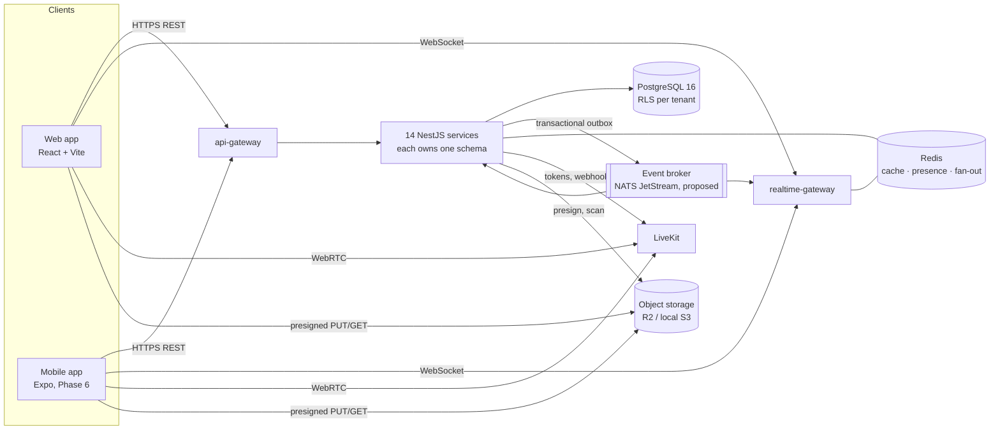

# Architecture

Single source of truth for SmartConnect's architecture. When a document here and an ADR disagree, the most recent **Accepted** ADR wins, and this index must be updated in the same pull request.

| Topic | Document | Status |
|---|---|---|
| Blueprint modules → services, schema gap register | [blueprint-mapping.md](blueprint-mapping.md) | Phase 0 |
| Data architecture: one database, 14 service-owned schemas, roles, outbox | [../database/architecture.md](../database/architecture.md) | Implemented |
| Tenant isolation (RLS, `withTenant()`) | [../database/tenant-isolation.md](../database/tenant-isolation.md) | Implemented |
| API conventions (REST, errors, pagination, auth, versioning) | [../api/conventions.md](../api/conventions.md) | Proposed |
| Real-time delivery (Socket.IO, ordering, resync, presence) | [realtime.md](realtime.md) | Proposed |
| Design system foundations | [design-system.md](design-system.md) | Foundations defined |
| Testing strategy and acceptance scenarios | [../devops/testing-strategy.md](../devops/testing-strategy.md) | Defined |
| Delivery phases | [../product/roadmap.md](../product/roadmap.md) | Phase 0 |
| Decisions | [../decisions/](../decisions/README.md) | 0001 and 0003 accepted; 0002 and 0004–0007 proposed |

## System overview

