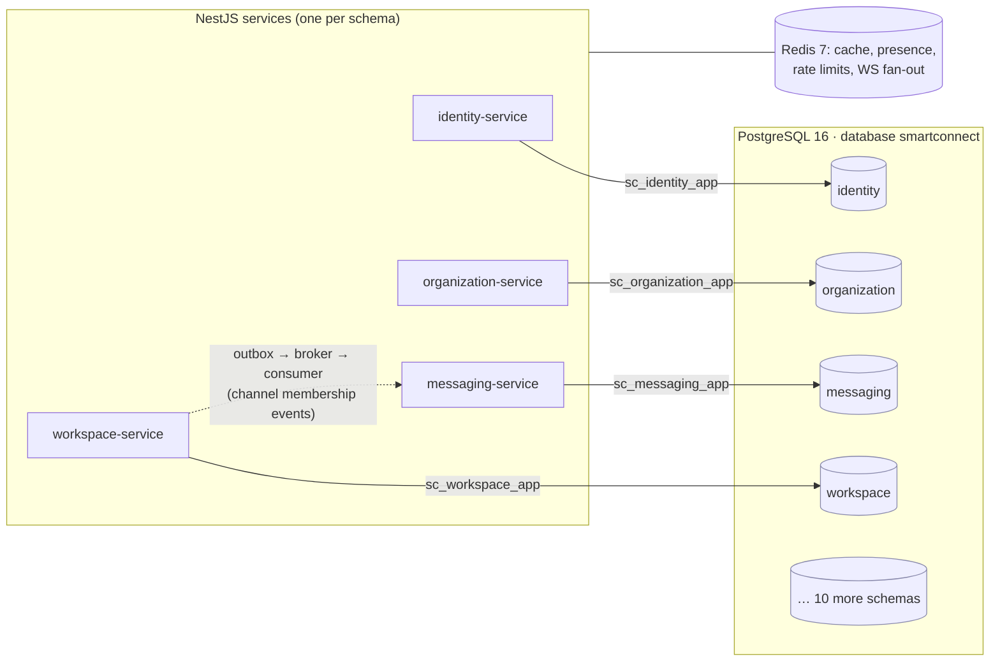
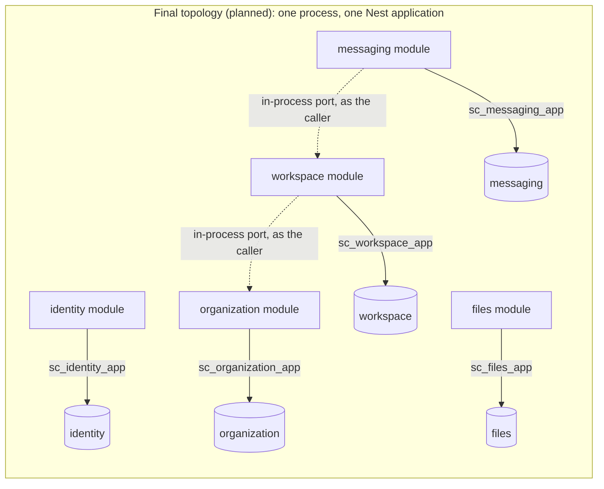

# Database architecture

**Status:** implemented and verified locally (2026-11-02). Production rollout pending.

## Summary

- **One PostgreSQL 16 server, one database (`smartconnect`), 14 service-owned schemas.** No per-service servers.
- **Every service owns its schema, its database roles, its Prisma schema, its migrations and its migration history** (`<schema>._prisma_migrations`).
- **Ownership is enforced by PostgreSQL privileges, not by convention.** A service's roles cannot read, write or alter any other schema. Tests attempt it and assert `permission denied`.
- **Services never share tables.** They talk over REST/internal APIs (synchronous) and over events published from a **transactional outbox** (asynchronous, durable).
- **Redis is for caching, ephemeral coordination and WebSocket fan-out only.** It is never the durable event source.
- **Multi-tenancy is enforced in the database** with row-level security (RLS) on every tenant table and tenant-aware composite foreign keys. See [tenant-isolation.md](tenant-isolation.md).
- **Today each service with code runs as its own NestJS process.** [ADR 0016](../decisions/0016-unified-backend.md) (Accepted 2026-11-03) plans one unified application, migrated in stages. **That has not been built.** It changes how the code is deployed, not who owns which schema: see [Deployment topology](#deployment-topology).



## Service ownership

| Service | Schema | Runtime role | Migration/owner role | Domain tables | Tenant-scoped (RLS) |
|---|---|---|---|---|---|
| identity | `identity` | `sc_identity_app` | `sc_identity_migrator` | users, credentials, user_profiles, devices, sessions, verification_tokens | No: global accounts |
| organization | `organization` | `sc_organization_app` | `sc_organization_migrator` | organizations, organization_roles, organization_members, organization_invitations | Yes (+ user-scoped read) |
| workspace | `workspace` | `sc_workspace_app` | `sc_workspace_migrator` | workspaces, workspace_members, channels, channel_members | Yes |
| messaging | `messaging` | `sc_messaging_app` | `sc_messaging_migrator` | conversations, conversation_members, messages, message_threads, message_reactions, message_attachments, message_mentions, message_bookmarks, message_read_states | Yes |
| presence | `presence` | `sc_presence_app` | `sc_presence_migrator` | user_statuses (live presence lives in Redis) | Yes |
| meetings | `meetings` | `sc_meetings_app` | `sc_meetings_migrator` | meetings, meeting_invitations, meeting_participants, meeting_recordings, meeting_events | Yes |
| files | `files` | `sc_files_app` | `sc_files_migrator` | files, file_versions | Yes |
| notifications | `notifications` | `sc_notifications_app` | `sc_notifications_migrator` | notifications, notification_preferences, notification_deliveries | Yes |
| search | `search` | `sc_search_app` | `sc_search_migrator` | search_documents, saved_searches, search_history | Yes |
| documents | `documents` | `sc_documents_app` | `sc_documents_migrator` | documents, document_versions, document_comments | Yes |
| tasks | `tasks` | `sc_tasks_app` | `sc_tasks_migrator` | task_lists, tasks, task_assignees, task_comments | Yes |
| workflows | `workflows` | `sc_workflows_app` | `sc_workflows_migrator` | workflows, workflow_versions, workflow_triggers, workflow_executions | Yes |
| integrations | `integrations` | `sc_integrations_app` | `sc_integrations_migrator` | integration_connections, webhooks, webhook_deliveries | Yes |
| administration | `administration` | `sc_administration_app` | `sc_administration_migrator` | audit_logs, security_policies, retention_policies | Yes |

Every schema also contains `outbox_events`, `processed_events` and `_prisma_migrations`. That makes 54 domain tables + 42 infrastructure tables = 96. The API gateway owns no data and has no database credentials.

The authoritative service list is the `services` array in [`010_bootstrap.sql`](../../infrastructure/compose/postgres/init/010_bootstrap.sql). A test asserts it matches the tooling and the `smartconnect-backend/services/*` directories.

## Deployment topology

[ADR 0016](../decisions/0016-unified-backend.md) moves SmartConnect from one process per service to one modular NestJS application, in stages.
- **Built:** the seven-process topology (still the default, and the rollback path) and Phase 1 (`make backend-start`, built and verified locally on 2026-11-04; not deployed).
- **Planned:** the final topology.

**What stays the same in every topology:**
- each service keeps its schema, its migrator and runtime roles, its Prisma project and its migration history;
- each service connects **only with its own runtime role**;
- RLS, the SECURITY DEFINER functions and the privileges that make SQL across schemas fail are unchanged;
- migrator credentials never reach a running process.

| | Seven processes (implemented) | Phase 1: one process (implemented, local) | Final modular monolith (planned, not built) |
|---|---|---|---|
| Processes | Seven: `api-gateway`, `realtime-gateway`, and the identity, organization, workspace, messaging and files services | One process (`smartconnect-backend/app`) hosting the seven existing applications. The services and the realtime gateway listen on internal loopback ports; the API gateway owns the one public port, which also carries Socket.IO | One process and one Nest application. Each service with code is a feature module; the nine schema-only services get no module |
| Database connections | One pool per service process, with `sc_<svc>_app` | Unchanged: one pool per hosted service, each with its own runtime role | One pool per module, each with its own runtime role. **Never a shared role** |
| Reading another service's data | HTTP call to its API with the caller's token | Unchanged, over loopback | The owning module's in-process port, with the same checks as the HTTP endpoint it replaces |
| SQL across schemas | Impossible (privileges) | Impossible | Impossible |
| Migrations | Per service, with its migrator role (`make db-migrate`) | Unchanged | Unchanged. The production runner is pending (ADR 0016, P3) |
| Events | Outbox rows in each schema (no relay yet); messaging publishes to Redis pub/sub for realtime | Unchanged | Unchanged |



## Communication rules

| Need | Mechanism | Never |
|---|---|---|
| Read another service's data synchronously | Its REST/internal API (cached in Redis where appropriate) | Cross-schema SQL or joins. Privileges make it impossible anyway |
| React to another service's changes | Consume its events. Keep a local **projection** if needed (e.g. messaging's `conversation_members` mirrors workspace channel membership; search's `search_documents`) | Polling another schema |
| Publish a change durably | Insert into own `outbox_events` **in the same transaction** as the state change; the service's relay publishes afterwards | Publishing to a broker inside the business transaction (dual-write) |
| Consume idempotently | Record `(event_id, handler)` in own `processed_events` in the same transaction as the handler's writes | Assuming exactly-once delivery |
| Ephemeral state | Redis with TTLs (presence heartbeats, typing, rate limits, locks, Socket.IO adapter) | Durable business state in Redis |

In the final topology of [ADR 0016](../decisions/0016-unified-backend.md), "its REST/internal API" means the owning module's in-process port. The port applies the same authorization as the HTTP endpoint it replaces; every other rule in this table is unchanged.

```mermaid
sequenceDiagram
  participant API as workspace-service
  participant WS as workspace schema
  participant Relay as outbox relay
  participant Broker as broker (decision pending)
  participant MSG as messaging-service
  participant MS as messaging schema
  API->>WS: BEGIN; insert channel_members; insert outbox_events; COMMIT
  Relay->>WS: select … where published_at is null order by occurred_at for update skip locked
  Relay->>Broker: publish workspace.channel_member.added (event id = outbox id)
  Relay->>WS: update outbox_events set published_at = now()
  Broker->>MSG: deliver (at-least-once)
  MSG->>MS: BEGIN; insert processed_events (dedupe); upsert conversation_members; COMMIT
```

Delivery is at-least-once, so consumers deduplicate on `processed_events`. Published outbox rows are retained (7 days recommended) so events can be replayed after a broker outage. **The broker technology is a pending decision** (see [Open decisions](#open-decisions)).

## Prisma architecture

Prisma **7.10.1** is pinned. The npm `latest` tag for the `prisma` CLI pointed at `8.0.0-rc.29` on 2026-11-02, while `@prisma/client` latest was 7.10.1. The CLI and client must match, and a release candidate is not a foundation.

| Decision | Choice | Why |
|---|---|---|
| Projects | One Prisma project per service: `services/<svc>/prisma/schema.prisma`, `prisma.config.ts`, `prisma/migrations/` | Independent ownership, migration history and deployability |
| Schema targeting | Single schema per project via the connection URL (`?schema=<svc>`); **not** `multiSchema` | Tables stay unqualified, `_prisma_migrations` lands in the service's own schema, and a project cannot even name another schema |
| Shared Prisma package | **None** | A shared client or schema would couple services' data models |
| Generator | `prisma-client` (Prisma 7), `moduleFormat = "esm"`, `importFileExtension = "js"`, output `src/generated/prisma` (gitignored) | NestJS 12 is ESM; `nodenext` resolution |
| Runtime driver | `@prisma/adapter-pg` (`pg` pool) with `{ schema }` | Prisma 7 runs queries through driver adapters |
| Credentials | Runtime `DATABASE_URL` (`sc_<svc>_app`) in `.env`. CLI `MIGRATION_DATABASE_URL` (`sc_<svc>_migrator`) in `.env.migration`, read only by `prisma.config.ts` | The running service never holds DDL credentials |
| Access module | `src/database/client.ts`: `createPrismaClient()` and `withTenant()` (+ `withUser()` in organization) | The single place a `PrismaClient` is built; tenant context is impossible to forget |
| Preview features | `partialIndexes` | Partial unique keys (soft-deleted slugs, pending invitations) and hot-path partial indexes |

Prisma 7.10 behaviours this design depends on are each covered by a test or by the tooling. Details: [migrations.md](migrations.md#prisma-710-behaviours-verified).

## Capacity and sizing

**Target:** 1,000–1,500 connected users and 10–30 concurrent meeting rooms. That is a modest OLTP load for a single PostgreSQL instance. The design keeps the heavy paths cheap:

- Message timeline reads use a partial composite index `(conversation_id, created_at DESC, id DESC) WHERE thread_root_id IS NULL` with keyset pagination.
- UUIDv7 primary keys keep inserts append-mostly in B-tree indexes.
- Read state is one row per (conversation, user), not per message.
- Live presence stays out of PostgreSQL entirely: ~1,500 heartbeats/min go to Redis.
- Partitioning is **not** needed at this scale. Revisit `messages`, `audit_logs` and `webhook_deliveries` past ~50M rows (time-range partitions, drop old partitions for retention).

**Connection budget**

| Environment | Budget |
|---|---|
| Local dev | `max_connections = 100`. `createPrismaClient()` defaults to a pool of **5**: 14 services × 5 = 70, leaving headroom for migrations and tooling. Each runtime role is capped at `CONNECTION LIMIT 25`, each migrator at 5, so one runaway service cannot starve the rest. |
| Production | Put **PgBouncer in transaction mode** in front of PostgreSQL. `withTenant()` uses `set_config(…, true)`, which is transaction-scoped and PgBouncer-safe. Size `max_connections` (e.g. 200) from the instance class, not from pool sums. |

**Local container sizing** for an 8 GB Apple Silicon Mac (Docker VM ≈ 3.8 GB): PostgreSQL limit 1 GB (`shared_buffers 256MB`, `effective_cache_size 768MB`, `work_mem 8MB`, `maintenance_work_mem 64MB`, `shm_size 256mb`). Redis limit 384 MB (`maxmemory 256mb`). The test instance (tmpfs, `fsync=off`) has a 1 GB limit and runs only when needed. Idle measured usage was ~25 MB (PostgreSQL) and ~10 MB (Redis).

## Environments

| Aspect | Local development (this repo) | Production (required) |
|---|---|---|
| PostgreSQL | `postgres:16-alpine` container, named volume, `127.0.0.1:15432` | Managed PostgreSQL 16 (or HA cluster) with automated failover, encryption at rest, private network only |
| Network exposure | Loopback only (`127.0.0.1`) | No public endpoint; security groups limited to service subnets |
| TLS | Off (loopback) | Required: `hostssl` only in `pg_hba`, clients use `sslmode=verify-full` |
| Admin account | `smartconnect_admin` (superuser from the image) | Platform admin role used only by the bootstrap/migration pipeline, never by services |
| Secrets | Gitignored `.env` files (mode 600) and Compose secrets (`/run/secrets`) | Secrets manager (AWS Secrets Manager / GCP Secret Manager / Vault), injected per workload. Migrator secret only to the migration job |
| Bootstrap | `make db-bootstrap` (or init script on a fresh volume) | Same SQL file, applied by the platform pipeline as the admin role |
| Migrations | `make db-migrate` | CI/CD job per service: `prisma migrate deploy` with the migrator secret, before rollout ([migrations.md](migrations.md#production-execution)) |
| Pooling | Prisma pool (5 per service) | PgBouncer (transaction mode) + small per-instance pools |
| Backups | `make db-backup` (logical `pg_dump`) | Continuous WAL archiving + daily base backups (PITR), cross-region copy, quarterly restore drills ([backup-and-restore.md](backup-and-restore.md)) |
| Data checksums | Off on the existing local volume (created before this phase); on for any fresh volume (`--data-checksums`) | On |
| Redis | Single container, password auth, AOF | Managed Redis with TLS, ACL users per service, no persistence requirement beyond warm restarts |
| Test database | Disposable `postgres-test` container (tmpfs, `127.0.0.1:15433`) | CI service container (same Compose profile) |

## Open decisions

These require a human decision. Nothing in the current implementation blocks on them.

1. **Event broker**: NATS JetStream (recommended: lightweight, durable streams, fits 14 services), RabbitMQ, or Redis Streams. Redis Streams is acceptable only because the outbox remains the source of truth.
2. **Managed PostgreSQL provider and region**: drives PITR, HA and encryption-at-rest specifics.
3. **Recovery objectives**: proposed RPO ≤ 5 min, RTO ≤ 1 h ([backup-and-restore.md](backup-and-restore.md#objectives)).
4. **Search engine**: PostgreSQL full-text search is in place. Move to OpenSearch or Meilisearch only if relevance or latency demands it.
5. **Homebrew PostgreSQL on the developer Mac**: a host `postgresql@16` service owns `localhost:5432`, which is why SmartConnect uses 15432. Stopping it (`brew services stop postgresql@16`) would allow 5432 again; it may be used by other projects.
