<!-- GENERATED by infrastructure/scripts/db-docs.mjs from the live catalog. Do not edit by hand. -->
# SmartConnect database ERD

Generated from the deployed dev database. It reflects the migrations, not intentions. Regenerate with `node infrastructure/scripts/db-docs.mjs` after `make db-migrate`.

- **Overview** shows the core entities across services. Dotted lines are *logical* cross-service references: UUID columns with no foreign key, kept consistent by events ([relationships.md](relationships.md)).
- **Per-service diagrams** show every domain table with exact columns and foreign keys. Composite tenant foreign keys are labelled by their non-tenant column. `organization_id` is implied, and both columns are enforced together. ([tenant-isolation.md](tenant-isolation.md)).
- `outbox_events`, `processed_events` and `_prisma_migrations` exist in **every** schema and are omitted from the diagrams.

## Overview (cross-service)

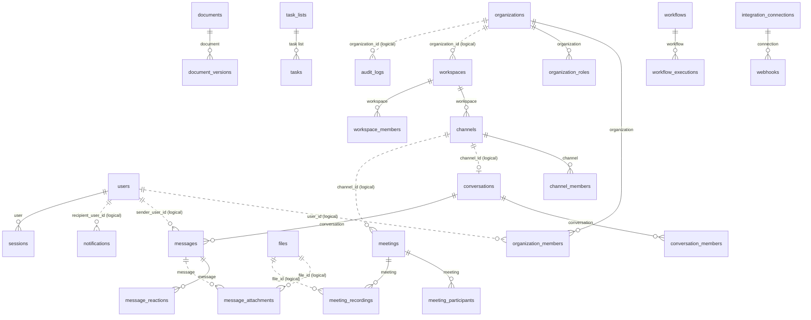

## identity

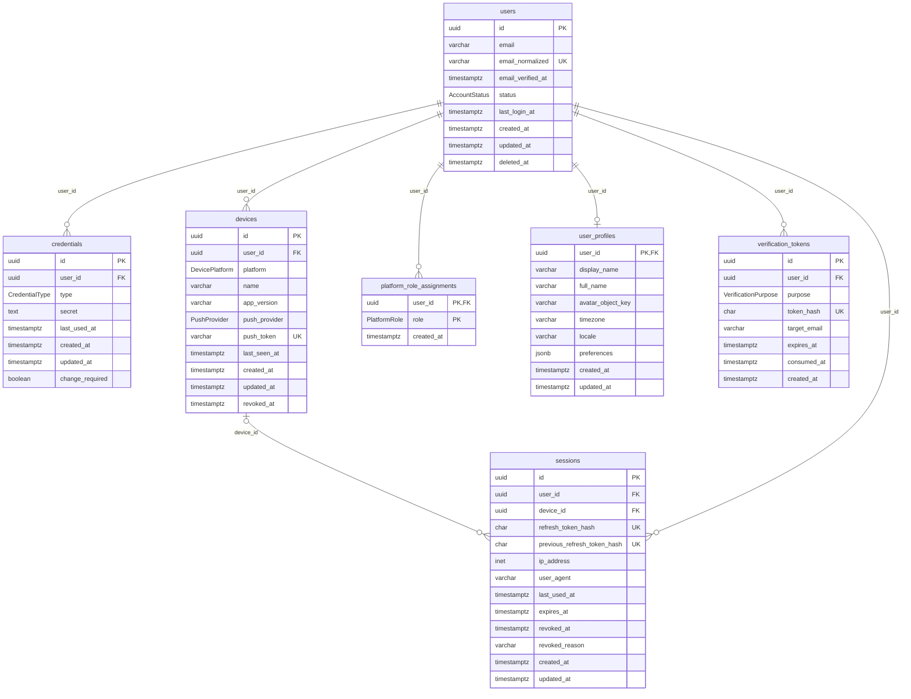

## organization

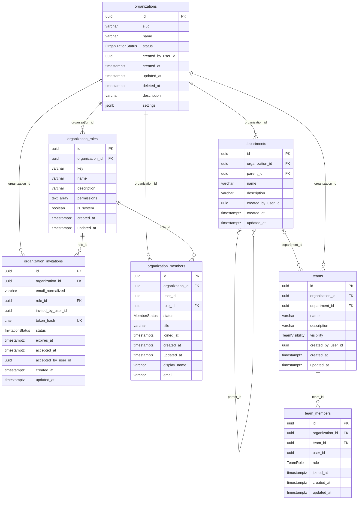

## workspace

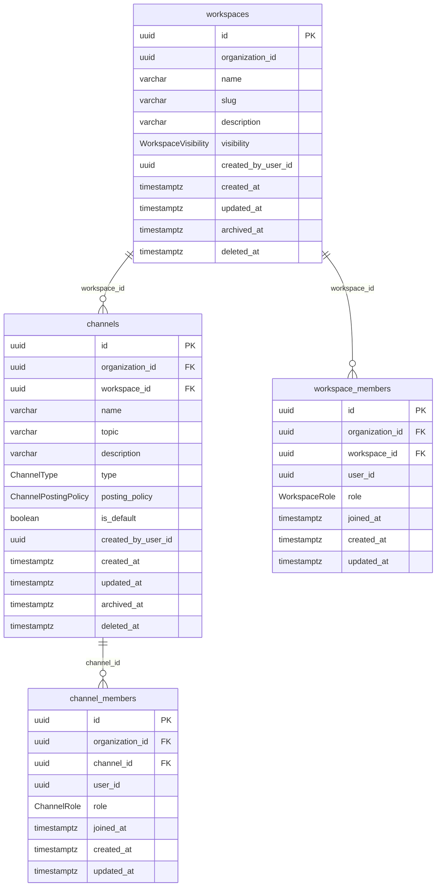

## messaging

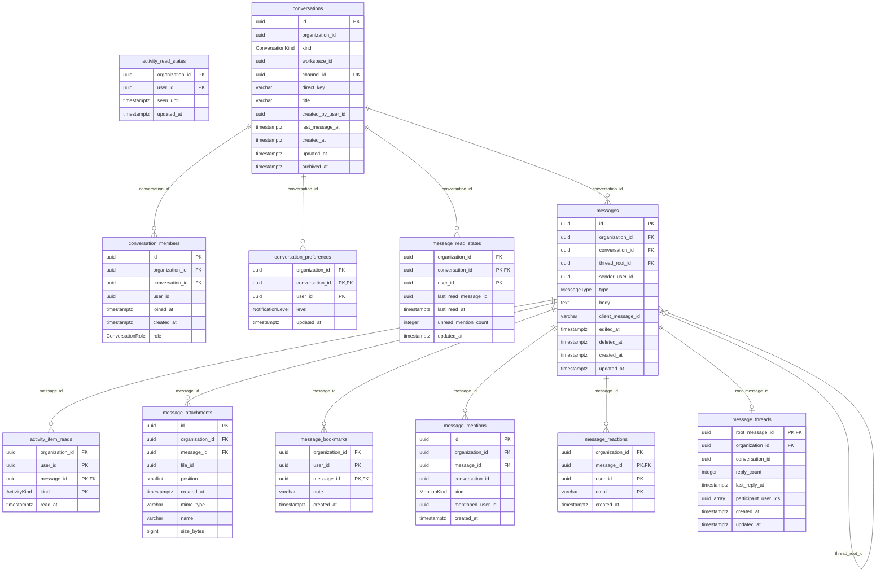

## presence

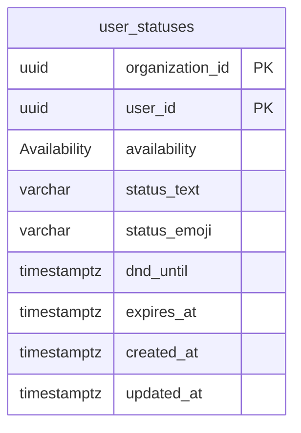

## meetings

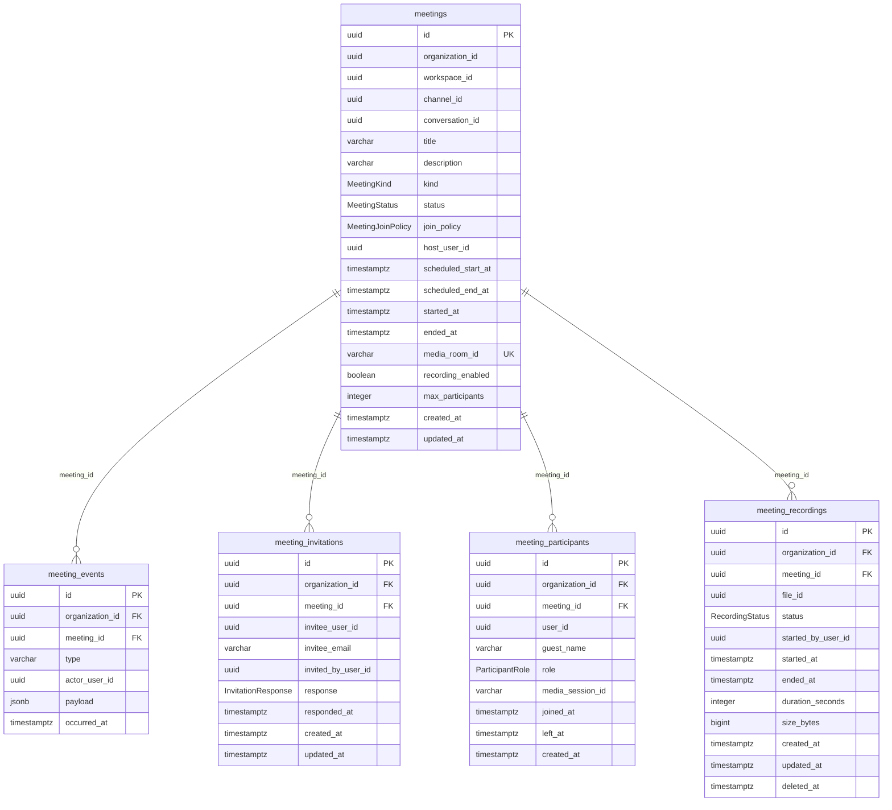

## files

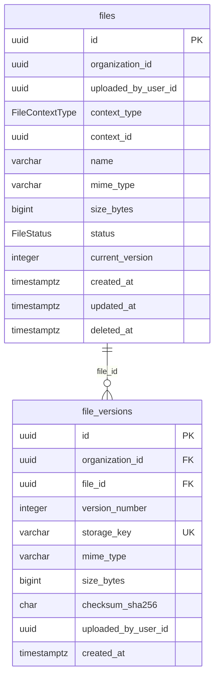

## notifications

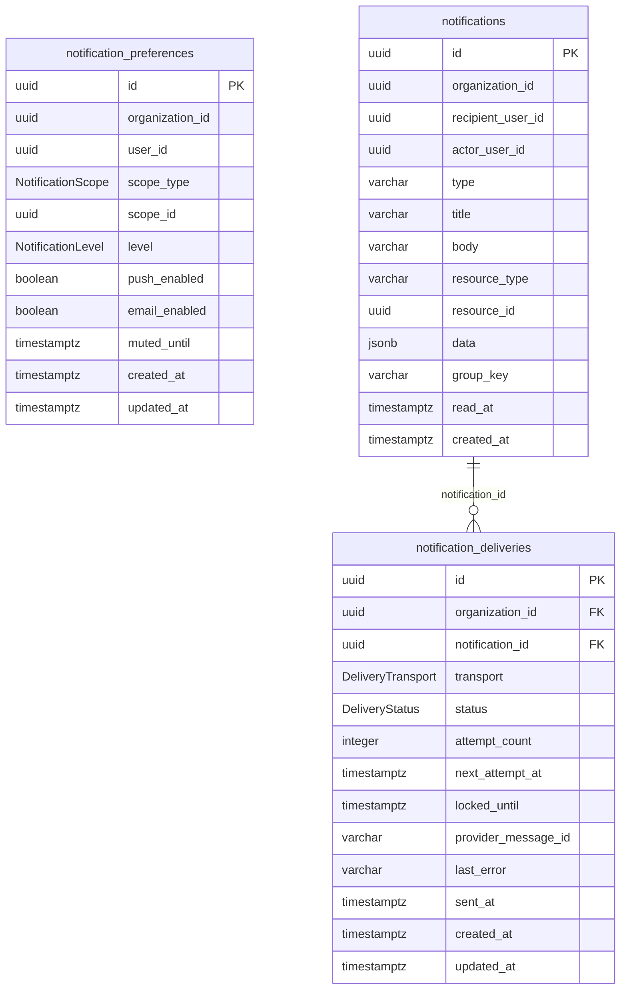

## search

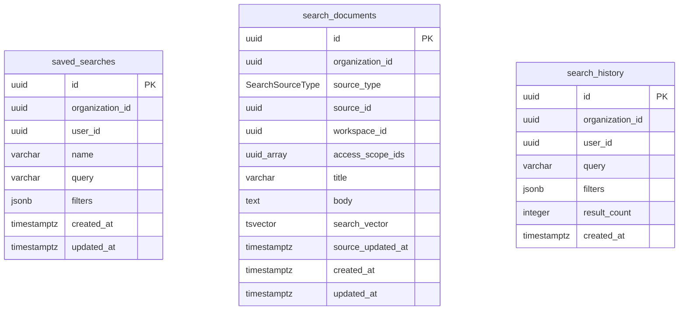

## documents

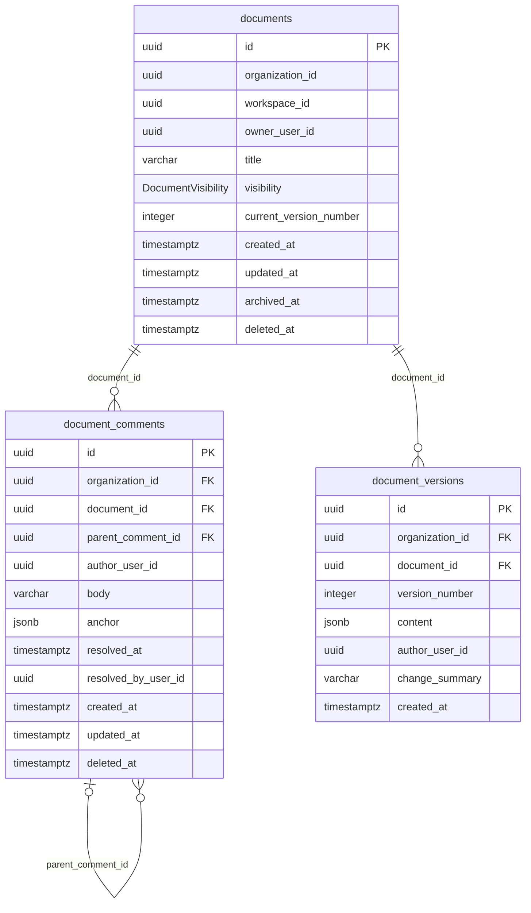

## tasks

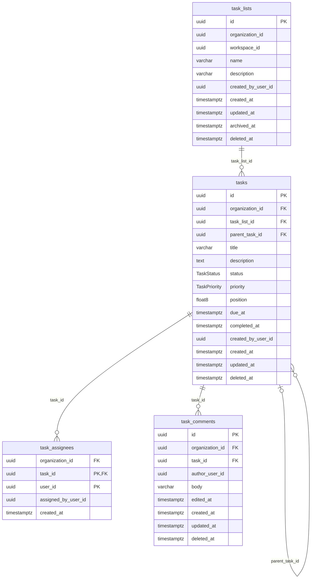

## workflows

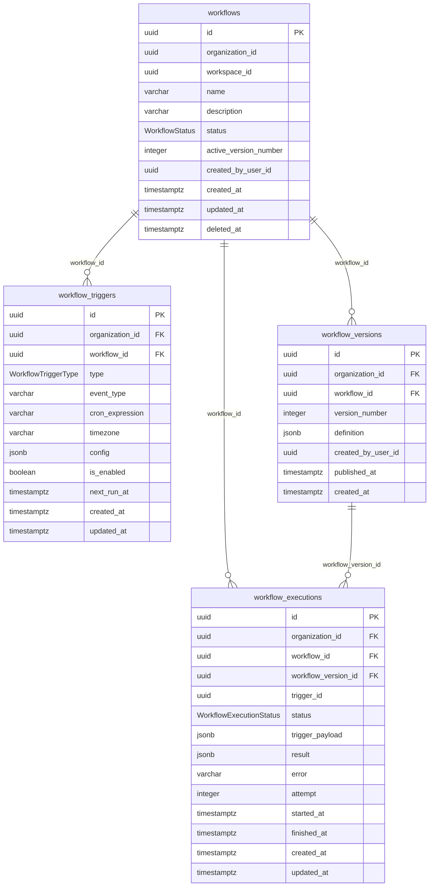

## integrations

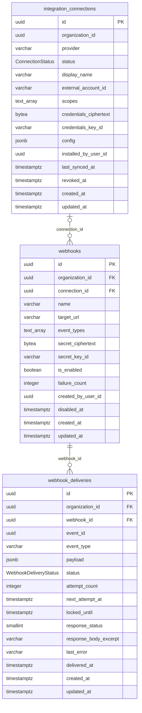

## administration

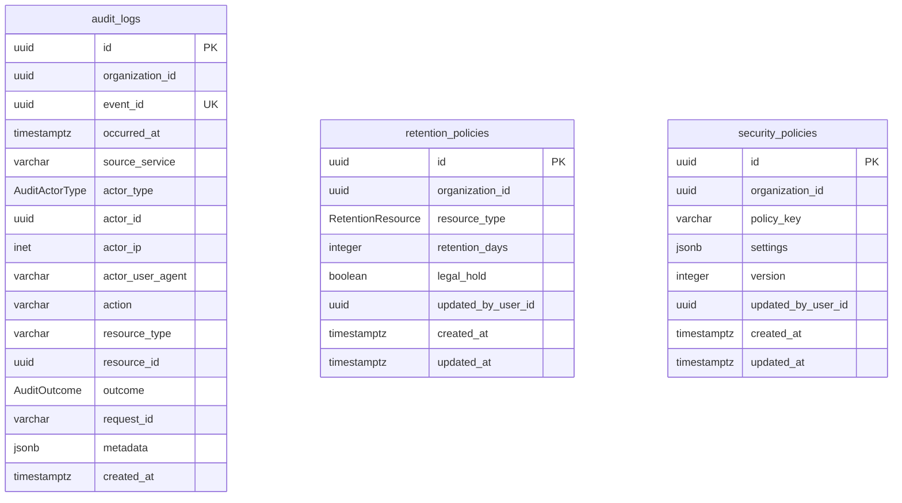

