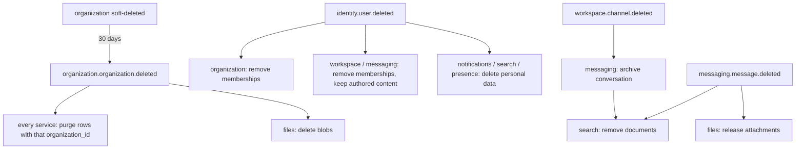

# Relationships

Two kinds of relationship exist, and they behave differently:

| | Inside one service schema | Across services |
|---|---|---|
| Representation | Real foreign keys (tenant-aware composite where tenant-scoped) | Plain UUID column, **no FK**, annotated `→ service.table (logical)` |
| Integrity | Immediate (PostgreSQL) | Eventual (events + idempotent handlers) |
| Deletion | `ON DELETE` rules below | The owner publishes an event; dependants react |
| Reads | Joins | API call, or a local projection |

## Foreign keys inside a schema

Exact definitions are in [schema-reference.md](schema-reference.md) and the diagrams in [erd.md](erd.md). The policy behind them:

| Rule | Applied to | Reason |
|---|---|---|
| **Composite tenant FK** `(organization_id, x_id) → parent(organization_id, id)` | Every relation between tenant tables, required **or optional** | A FK check runs as the table owner and ignores RLS. Without the composite key, a row in tenant A could reference a parent in tenant B (tested: rejected) |
| `ON DELETE CASCADE` | Children that have no meaning without the parent: members, versions, reactions, attachments, mentions, bookmarks, read states, deliveries, thread replies, comments, subtasks | Hard purges (retention, organization deletion) remove whole aggregates |
| `ON DELETE RESTRICT` | `organization_members.role_id` (cannot delete an assigned role); `workflow_executions.workflow_version_id` (history pins its version) | Prevents silent loss of meaning |
| `ON DELETE SET NULL` | `identity.sessions.device_id` only (single-column FK, global table) | A session outlives a device record. Composite tenant FKs cannot SET NULL without nulling `organization_id` |
| No FK by design | `message_read_states.last_read_message_id`, `workflow_executions.trigger_id` | A cursor or history must survive purges and edits |

Soft deletion does not trigger FK actions. Soft-deleted parents keep their children until the retention purge hard-deletes the aggregate.

## Cross-service references

| Column(s) | Points to | Consistency mechanism |
|---|---|---|
| `organization_id` (every tenant table outside organization) | `organization.organizations.id` | Created only after the organization service has confirmed membership (layer 1). On `organization.organization.deleted` (after the 30-day window) each service purges the tenant |
| `*_user_id`, `user_id` (all services) | `identity.users.id` | On `identity.user.deleted`: memberships removed, authored content kept with the id (shown as "Deleted user"), personal data (bookmarks, preferences, search history, statuses) deleted |
| `messaging.conversations.channel_id`, `workspace_id` | `workspace.channels` / `workspaces` | Messaging creates the channel conversation on `workspace.channel.created` and archives it on `workspace.channel.archived/deleted` |
| `messaging.conversation_members` (channel kind) | `workspace.channel_members` | **Projection**, maintained from `workspace.channel_member.added/removed` |
| `messaging.message_attachments.file_id`, `meetings.meeting_recordings.file_id` | `files.files` | Files publishes `files.file.deleted`; messaging removes the attachment rows. The owning service records the reference before the upload is finalised |
| `files.files.context_type/context_id` | message / document / task / meeting recording / workspace | When the owner deletes the context, it publishes an event; files soft-deletes the blobs |
| `meetings.meetings.channel_id`, `conversation_id` | workspace / messaging | Informational; validated at creation via API |
| `documents.documents.workspace_id`, `tasks.task_lists.workspace_id`, `workflows.workflows.workspace_id` | `workspace.workspaces` | On `workspace.workspace.deleted`: archive dependent items |
| `search.search_documents.source_id` (+ `access_scope_ids`) | Any searchable resource | Upserted from `*.created/updated` events, deleted on `*.deleted`; `source_updated_at` ignores stale events |
| `administration.audit_logs.event_id` | The producing service's `outbox_events.id` | Idempotent ingestion (unique `event_id`) |
| `identity.devices.push_token` | used by notifications | Notifications resolves push targets through the identity internal API (cached in Redis); never reads the identity schema |

## Event conventions

- **Name:** `<service>.<entity>.<past-tense-verb>`, e.g. `workspace.channel_member.added`, `messaging.message.created`, `identity.user.deleted`.
- **Envelope (outbox row):** `id` (UUIDv7 = event id), `aggregate_type`, `aggregate_id`, `event_type`, `event_version`, `organization_id`, `payload` (jsonb), `headers` (correlation/trace ids), `occurred_at`.
- **Payloads carry ids and the changed facts, never secrets.** Message bodies are only included in events consumed by search (needed for indexing).
- **Versioning:** additive changes keep `event_version`. Breaking changes bump it, and producers dual-publish during migration.
- **Ordering:** per aggregate only (relay orders by `occurred_at, id`). Consumers must tolerate reordering across aggregates.

## Deletion cascades across services

